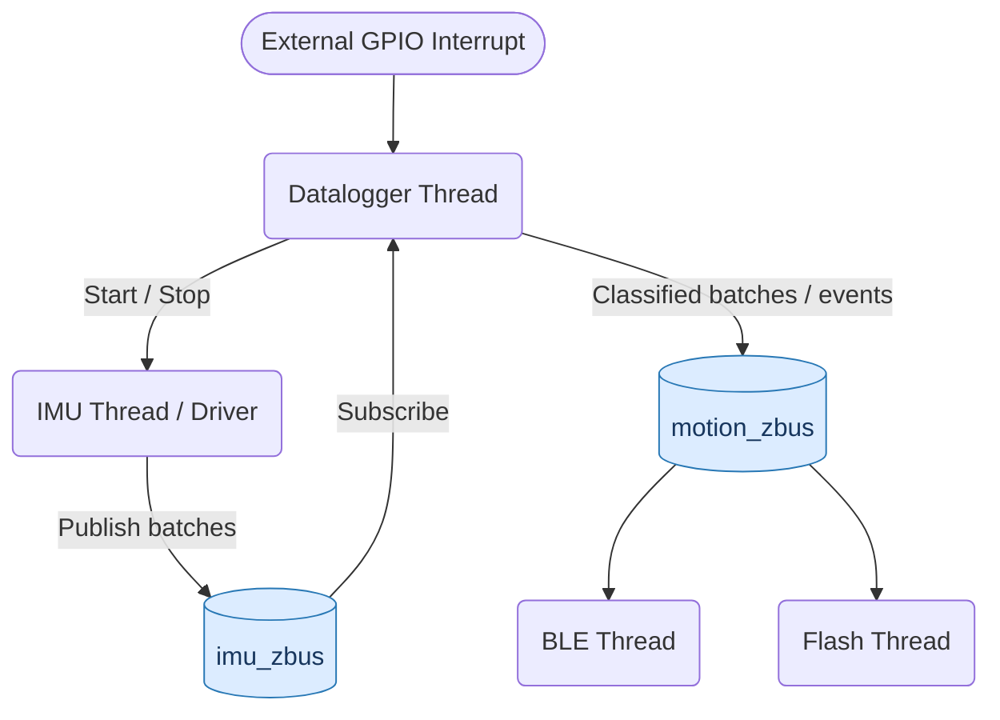

# IMU Datalogger (Avelo Technical)

A motion-triggered IMU datalogger built with Zephyr RTOS. An external virtual GPIO interrupt wakes the application, which processes simulated IMU batches through a motion classifier. A black-box algorithm determines if motion is detected. While motion is detected, batches are streamed over a ZBus to a simulated BLE interface and a simulated flash interface. Only motion batches are published downstream; no-motion batches are dropped at the source. The application records lifecycle events and returns to sleep after five minutes of inactivity.

The project uses `native_sim` to validate application logic and message flow without requiring physical peripherals.

Note: Timestamp data is passed through, but does not appear in the logs.

## Threads

| Thread | Priority | Responsibility |
|---|---:|---|
| `datalogger` | 4 | Waits for wakeup, processes IMU batches, manages the inactivity timer, and publishes lifecycle events. |
| `imu` | 5 | Simulates IMU acquisition, FIFO batching, and watermark notifications; publishes batches on `imu_zbus`. |
| `ble` | 6 | Simulates streaming batches containing motion. |
| `flash` | 6 | Logs lifecycle events and stores IMU batches associated with detected motion. |
| `Simulation threads` | 7 | Generate sensor activity and simulate external wakeup events. |

`main()` initializes the modules and starts the application threads. Lower numerical priority values indicate higher priority.

## Architecture



Two zbus channels separate sensor acquisition from application-level events:

- **`imu_zbus`** carries raw IMU batches to the datalogger.
- **`motion_zbus`** carries classified batches and lifecycle events to BLE and flash consumers.

The datalogger owns the activity lifecycle and is the only module that classifies motion. BLE and flash consume published messages rather than reading shared application state.

## Activity lifecycle

1. **Sleep:** The datalogger blocks on a wakeup semaphore. This represents sleeping in `native_sim`; it is not a real CPU power state.
2. **Wakeup:** A simulated falling-edge GPIO interrupt signals the datalogger, which starts the IMU and publishes a wakeup event.
3. **Watermark interrupt:** The simulated IMU fills its FIFO to the watermark, then publishes a batch on `imu_zbus`.
4. **Active monitoring:** The datalogger classifies each batch. Only batches with detected motion are published on `motion_zbus`, so BLE and flash never see no-motion data. State changes publish `MOTION_DETECTED` / `NO_MOTION_DETECTED` events.
5. **No motion:** The first no-motion batch after motion starts a one-shot five-minute timer. Further no-motion batches leave it running.
6. **Motion resumes:** The timer is stopped and any pending timeout signal is cleared.
7. **Sleep transition:** When the timer expires, the datalogger publishes `INACTIVITY`, stops the IMU, publishes `SLEEP`, and drains any stale batches before returning to sleep.

The timer callback only gives a semaphore. The datalogger thread checks it every loop iteration (at most 50 ms) and performs the transition, keeping application logic out of timer context.

## Logging

Flash logging distinguishes lifecycle events from IMU data.

| Record | When it is generated |
|---|---|
| `WAKEUP` | The application wakes from its simulated sleep state. |
| `MOTION_DETECTED` | The classifier transitions from no motion to motion. |
| `NO_MOTION_DETECTED` | The classifier transitions from motion to no motion. |
| `SLEEP` | The application enters its simulated sleep state. |
| `IMU batch` | A batch is received while motion is detected. |

Motion and no-motion events are logged on state changes, rather than for every batch. IMU batches are stored only when motion is detected, so every stored batch is a motion batch.

## AI Usage
I used AI (Claude and ChatGPT) as a development assistant throughout the assessment to help review the requirements, explore Zephyr RTOS design options, troubleshoot build issues, and improve the documentation.

I reviewed the suggestions and made the final design decisions based on my understanding of the requirements and the constraints of the simulated environment.

AI assistance was particularly useful for reviewing edge cases and creating mock functions. I treated its suggestions as input to evaluate rather than assuming generated code or explanations were automatically correct.

As I am more familiar with FreeRTOS, I also leveraged AI for clarifying syntax, and what the equivalent Zephyr functions are compared to FreeRTOS functions.

## Known limitations / next steps
- Better handling of BLE historical payload requirement
- Updated comments and documentation
- Cleanup of configuration and includes and switching printk's to the Logging module (re-organize/remove any that were added but not needed due to changes during development.)

- Thread stacks are 1 KB, which is fine on `native_sim` but needs measuring (e.g. `CONFIG_THREAD_ANALYZER`) on a Cortex-M.
- `CONFIG_PM` is enabled but no power states are used; hardware would use PM states / deep sleep with GPIO wake.
- Unused Kconfig options (`APP_IMU_ODR_HZ`, `APP_IMU_FIFO_WATERMARK`, `MAIN_SLEEP_MS`) are not yet wired in.

The first 3 bullet points are the areas I would focus on if I had more time available.

## Sample output
```
*** Booting Zephyr OS build v4.5.0-rc1-297-g653d367889f5 ***
*** Booting Zephyr OS on native_sim ***
[IMU] Initialized
[Datalogger] Sleeping; waiting for wakeup
[SIM] Triggering wakeup
[Datalogger] Wakeup received
[IMU] Started
[Flash][Event] WAKEUP
[BLE] Streaming 10 IMU samples
[Flash][Event] MOTION_DETECTED
[Flash][IMU] Stored batch (10 samples)
[BLE] Streaming 10 IMU samples
[Flash][IMU] Stored batch (10 samples)
[BLE] Streaming 10 IMU samples
[Flash][IMU] Stored batch (10 samples)
[BLE] Streaming 10 IMU samples
[Flash][IMU] Stored batch (10 samples)
[BLE] Streaming 10 IMU samples
[Flash][IMU] Stored batch (10 samples)
[BLE] Streaming 10 IMU samples
[Flash][IMU] Stored batch (10 samples)
[BLE] Streaming 10 IMU samples
[Flash][IMU] Stored batch (10 samples)
[BLE] Streaming 10 IMU samples
[Flash][IMU] Stored batch (10 samples)
[BLE] Streaming 10 IMU samples
[Flash][IMU] Stored batch (10 samples)
[BLE] Streaming 10 IMU samples
[Flash][IMU] Stored batch (10 samples)
[Flash][Event] NO_MOTION_DETECTED
[IMU] Stopped
[Datalogger] Sleeping; waiting for wakeup
[Flash][Event] SLEEP
[SIM] Triggering wakeup
[Datalogger] Wakeup received
[IMU] Started
[Flash][Event] WAKEUP
[BLE] Streaming 10 IMU samples
[Flash][Event] MOTION_DETECTED
[Flash][IMU] Stored batch (10 samples)
[BLE] Streaming 10 IMU samples
[Flash][IMU] Stored batch (10 samples)
[BLE] Streaming 10 IMU samples
[Flash][IMU] Stored batch (10 samples)
Stopped at 373.670s```

# Criteria

## Receives a wakeup signal from an external INT GPIO.
Simulated using Zephyr's GPIO API and a virtual GPIO device.

The interrupt-driven approach avoids continuously polling the wakeup input, reducing unnecessary CPU activity.

**Assumption**: native_sim emulates the GPIO event but does not reproduce a physical interrupt controller or CPU sleep state.

## Upon wakeup, initializes/starts the IMU and consumes data from its FIFO via a watermark interrupt.
A simulated IMU module provides initialization, start/stop controls, FIFO batches, and watermark notifications.

**Assumption**: The simulated FIFO and watermark reproduce the intended data flow, not the timing or hardware behavior of a physical sensor.

## Passes all IMU FIFO data through a black-box algorithm to evaluate whether motion activity is detected.
A black-box classifier interface evaluates every received IMU batch.

**Assumption**: The current classifier is a deterministic mock that reports motion for the first ten batches after wakeup, then reports no motion. It demonstrates the application flow but is not a real motion-detection algorithm.

## Continuously streams incoming IMU FIFO data live over BLE ONLY when the black-box algorithm reports active motion.
A simulated BLE consumer subscribes to motion_zbus. The datalogger only publishes batches when motion is detected, so the BLE thread never receives no-motion data.

**Assumption**: The BLE interface validates application-level message flow. Actual Bluetooth connections, GATT characteristics, MTU negotiation, packet fragmentation, and radio behavior are outside the simulation.

## Stores IMU data to an external flash device ONLY when the black-box algorithm reports active motion.
A simulated flash consumer subscribes to motion_zbus. As above, only motion batches are published, so only motion batches are stored.

**Assumption**: The current storage implementation is a fixed-capacity, RAM-backed mock. It demonstrates record handling but does not provide persistent storage across resets or model physical flash erase behavior, endurance, or power-loss recovery.

## Logs distinct system events to the same flash device (specifically: wakeup time, activity detected time, inactivity detected time, and sleep time).
The datalogger publishes explicit lifecycle events to motion_zbus, which the flash consumer records separately from IMU samples, each with a timestamp.

## Streams historical stored IMU data from flash to a central device upon receiving a read/offload request over BLE.
A simulated read request (`rx_callback()`) submits a work item that walks the flash log in order and "transmits" each record. The simulation threads trigger one request after a fixed delay.

**Assumption**: The real implementation would pace notifications by MTU and connection credits, handle disconnects mid-transfer, and avoid competing with live streaming for radio time.

## Monitors activity state: if no motion activity is detected for 5 continuous minutes, logs inactivity and sleep events, stops the IMU, and returns the MCU to low-power sleep.
The datalogger owns the activity lifecycle and uses a one-shot Zephyr timer.

**Assumption**: The timer starts on the first no-motion batch after motion and is cancelled by any motion batch, so it fires after five continuous minutes without motion.

**Simulation limitation**: Waiting on a semaphore emulates an idle application thread. It does not put the simulated CPU into a real low-power state.

## Must be designed with CR2032 coin cell power operational constraints in mind.
The architecture is designed to minimize unnecessary processing, radio activity, and sensor operation, with hardware deep sleep as the intended deployment behavior.

The principal power-saving choices are:
- Use an external interrupt as the wakeup mechanism rather than continuously polling.
- Batch IMU samples through the FIFO and watermark mechanism.
- Gate live BLE streaming and IMU storage on the classifier's motion verdict at the source, so no-motion data is never copied to or processed by the consumers.
- Stop the IMU when the inactivity timeout completes.
- Block on semaphores and synchronization primitives when work is unavailable.
- Keep the simulated peripheral implementations simple so they do not obscure the intended power-management architecture.

**Assumption**: The current native_sim implementation cannot demonstrate actual CR2032 battery life, current consumption, peak-current behavior, or wakeup latency. These require measurements on the target hardware. The IMU, BLE radio, and flash device must be selected and configured to meet the battery's average- and peak-current constraints.