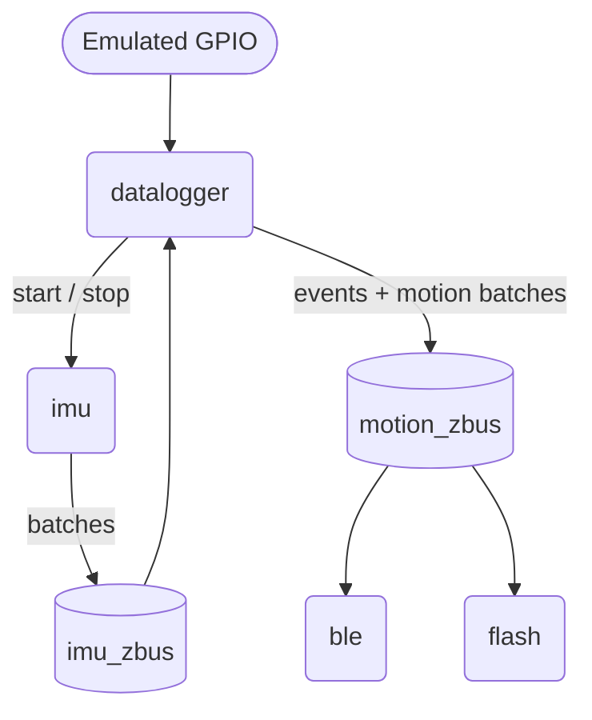

# IMU Datalogger (Zephyr, native_sim)

A motion-triggered IMU datalogger built on Zephyr RTOS and run on `native_sim`. Peripherals are mocked: the GPIO is emulated, and the IMU, BLE and flash are stubs. The goal is to show application structure and message flow, not hardware behavior.

## Build / run
```
west build -b native_sim .
west build -t run        # or ./build/zephyr/zephyr.exe
```

## Design decisions
- **Semaphores for sleep and wakeup.** The datalogger blocks on a semaphore while idle to stand in for low-power sleep, because `native_sim` cannot model it.
- **zbus.** Datalogger output has one publisher and two consumers (BLE and flash), so both subscribe to the same channel.
- **Two channels.** `imu_zbus` carries raw batches to the datalogger only. `motion_zbus` carries classified batches and events to BLE and flash. Classification happens in one place, and the BLE and flash threads are not woken for no-motion batches.
- **Timer plus semaphore.** The timer callback only gives a semaphore. The datalogger thread performs the state transition.
- **Shared state.** The flash log is protected by a mutex. Wake and timeout are signalled with semaphores. Data between threads is passed by copy through zbus.
- **Data loss is detected, not prevented.** A full mock FIFO, a failed publish and a full flash log each print a message. There is no retry or backpressure.

## Other Considerations
- I had considered using a single zbus, where the IMU transmits the data to the Datalogger, BLE, and Flash all on the same bus, the datalogger uses it's black box algorithim to determine if the data is valid, and then notifies the flash and ble via a sempahore when the motion is detected.  I changed to using 2 zbus channels instead as this method posed the chance of dropping valid IMU data while the datalogger is determining if motion had been detected.
- I had considered creating a seperate task for the BLE reading and transmitting historical data, but decided on a worker to keep the code concise, still prevent the RX Callback from taking too much time.  Depending on how much IMU data is expected, this may outgrow the scope of a work queue.

## Known gaps in this code that affect power
- The datalogger polls with a 50 ms timeout while active (should block).
- BLE streaming is unconditional (no connection/subscription check).
- Timestamps are uptime, which resets on a real deep-sleep cycle.

## How it works
1. `sim_wakeup_thread` pulses the emulated `sw0` GPIO low (falling edge) 10 s after boot, then every 6 minutes.
2. The GPIO callback gives a semaphore. The `datalogger` thread wakes, publishes a `WAKE` event and starts the IMU.
3. `sim_imu_thread` pushes one sample every 100 ms into a 20-entry message queue (the mock FIFO) while the IMU is started. When the queue holds 10 samples (`IMU_BATCH_SIZE`), it gives a semaphore (the mock watermark interrupt).
4. The `imu` thread reads a 10-sample batch from the FIFO, and publishes it on `imu_zbus`.
5. The datalogger classifies each batch with `detect_motion()`. This is a mock that reports motion for the first 10 batches after each wakeup and no motion after that.
   - On a change of classification (and on the first batch), it publishes `MOTION_DETECTED` or `NO_MOTION_DETECTED`.
   - Motion detected batches are published on `motion_zbus` as `BATCH`. No-motion batches are dropped here, so BLE and flash never see them.  This is to save cycles and power.
6. The first no-motion batch starts a one-shot 5-minute timer. Any motion batch cancels it.
7. When the timer fires, the datalogger stops the IMU, publishes `SLEEP`, drains stale batches and blocks on the wakeup semaphore again.



## Threads
| Thread | Prio | Role |
|---|---:|---|
| `datalogger` | 4 | Lifecycle, classification, inactivity timer, event publishing |
| `imu` | 5 | Drains FIFO on watermark, publishes batches |
| `ble` | 6 | Prints "streaming" for each motion batch |
| `flash` | 6 | Stores events and motion batches in a RAM log |
| `sim_imu`, `sim_wakeup` | 7 | Generate samples and wakeup pulses |

Each thread has a 1 KB stack. Lower numbers mean higher priority.

## Flash log
- RAM-backed array of 256 records, protected by a mutex.
- Record types are events (`WAKEUP`, `MOTION_DETECTED`, `NO_MOTION_DETECTED`, `SLEEP`) and IMU batches. Every record carries a `k_uptime_get_32()` timestamp. The timestamp is stored but not printed.
- When the log is full, new records are dropped with a message. Events and batches share the same space.

## BLE
- Live streaming is a stub (`tx_samples`) that prints the batch size.
- `rx_callback()` submits a work item that walks the flash log and prints each record. **Nothing calls `rx_callback()` in this simulation, so the offload path is stubbed but never exercised.**

## CR2032 considerations
Implemented (reduces activity):
- GPIO interrupt wakeup instead of polling for wake.
- The `imu` thread is woken once per 10 samples, not per sample.
- No-motion batches are never published to BLE or flash.
- The IMU is stopped when the inactivity timer fires.

Not implemented (ideas):
- Slowing the clock and disabling unneeded peripherals while running.
- Using Zephyr power-management states. `CONFIG_PM` and `CONFIG_PM_DEVICE` are enabled in `prj.conf`, but the application does not use them.
- Avoiding overlap of flash writes and radio transmission to limit peak current.
- Buffering flash writes by page.

## Known limitations
- **Datalogger polling:** while active, the datalogger waits on zbus with a 50 ms timeout and checks the timeout semaphore each pass. It is not fully blocking.
- **Sleep is not real:** `CONFIG_PM` is on but no power states are used. Sleep is a blocked semaphore. Hardware would use deep sleep with GPIO wake and an RTC for timestamps.
- **BLE:** streaming is unconditional (no connection or subscription check), and offload has no MTU pacing, flow control or disconnect handling.
- **Flash:** the real device would need page buffering, a ring log, erase handling and power-loss recovery.
- **CR2032:** battery life, peak current and wake latency can't be shown on `native_sim` and need measurement on target hardware.
- **Unused config:** `MAIN_SLEEP_MS` is defined but not used, and the Zephyr logging module is not used (`printk` only).
- **Stack sizes** need measuring on target (e.g. `CONFIG_THREAD_ANALYZER`).

## Sample output (abbreviated)
```
[IMU] Initialized
[Datalogger] Sleeping; waiting for wakeup
[SIM] Triggering wakeup
[Datalogger] Wakeup received
[IMU] Started
[Flash][Event] WAKEUP
[BLE] Streaming 10 IMU samples
[Flash][Event] MOTION_DETECTED
[Flash][IMU] Stored batch (10 samples)
... (10 motion batches)
[Flash][Event] NO_MOTION_DETECTED
[IMU] Stopped
[Datalogger] Sleeping; waiting for wakeup
[Flash][Event] SLEEP
[SIM] Triggering wakeup
```

## AI usage
I used Claude and ChatGPT to review requirements, explore Zephyr options, troubleshoot builds, mock peripherals and improve documentation. I'm more familiar with FreeRTOS, so I also used them to map concepts to Zephyr equivalents.


## Requirements and status

| Requirement | Implementation | Status |
|---|---|---|
| Wakeup from external INT GPIO | `sw0` alias (emulated `gpio0` pin 5, active low) is configured for a falling-edge interrupt. The callback gives `wakeup_sem`. | Done (emulated) |
| On wakeup, start IMU and consume FIFO via watermark interrupt | `datalogger` calls `imu_start()`. The mock FIFO is a 20-entry message queue; at 10 samples a semaphore (mock watermark interrupt) wakes the `imu` thread, which reads 10 samples and publishes them. | Done (mocked) |
| Pass all FIFO data through black-box algorithm | Every batch goes through `detect_motion()`, a static function in `datalogger.c`. It is a mock: motion for the first 10 batches after each wakeup, then no motion. It ignores the sample data. | Mock |
| Stream over BLE only on motion | Only motion batches are published to `motion_zbus`, so the `ble` thread never receives no-motion batches. `tx_samples()` only prints the batch size. | Stub (gating done) |
| Store to flash only on motion | Same gating. The `flash` thread stores motion batches in a RAM array. | Done (RAM mock) |
| Log wakeup, activity, inactivity and sleep events to flash | `WAKEUP` on wakeup. `MOTION_DETECTED` / `NO_MOTION_DETECTED` when the classification changes (and on the first batch). `SLEEP` when the 5-minute timer fires. | Partial: no event is logged at the 5-minute mark (see Assumptions) |
| Stream stored data over BLE on request | `rx_callback()` submits a work item to the system workqueue. The handler walks the flash log and prints each record's timestamp and either the sample count or the event number. It never reads sample values. Nothing calls `rx_callback()`. | Stub, never exercised |
| After 5 minutes without motion: log, stop IMU, sleep | A one-shot 5-minute timer starts at the first no-motion batch and is cancelled by any motion batch. When it fires, the datalogger stops the IMU, publishes `SLEEP`, drains queued batches, clears the wakeup semaphore and blocks on it. | Partial: sleep is a blocked semaphore, not a real low-power state |
| CR2032 constraints | See "CR2032 considerations". | Partial |
